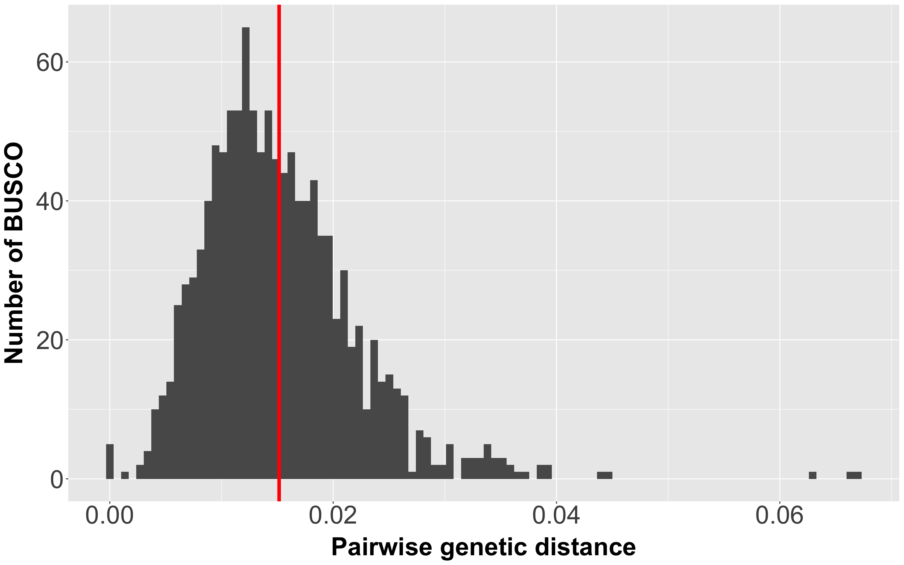
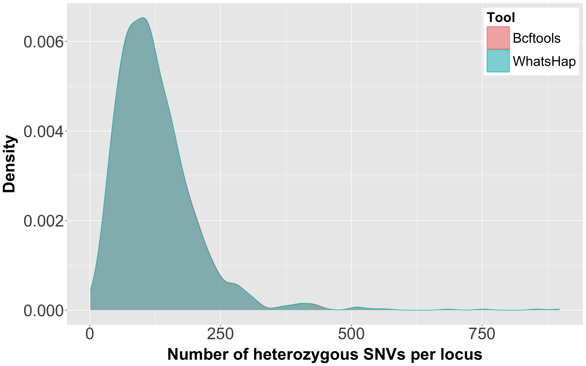
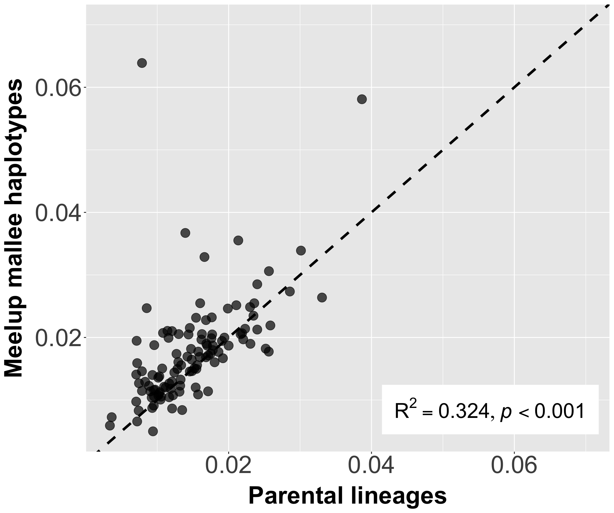
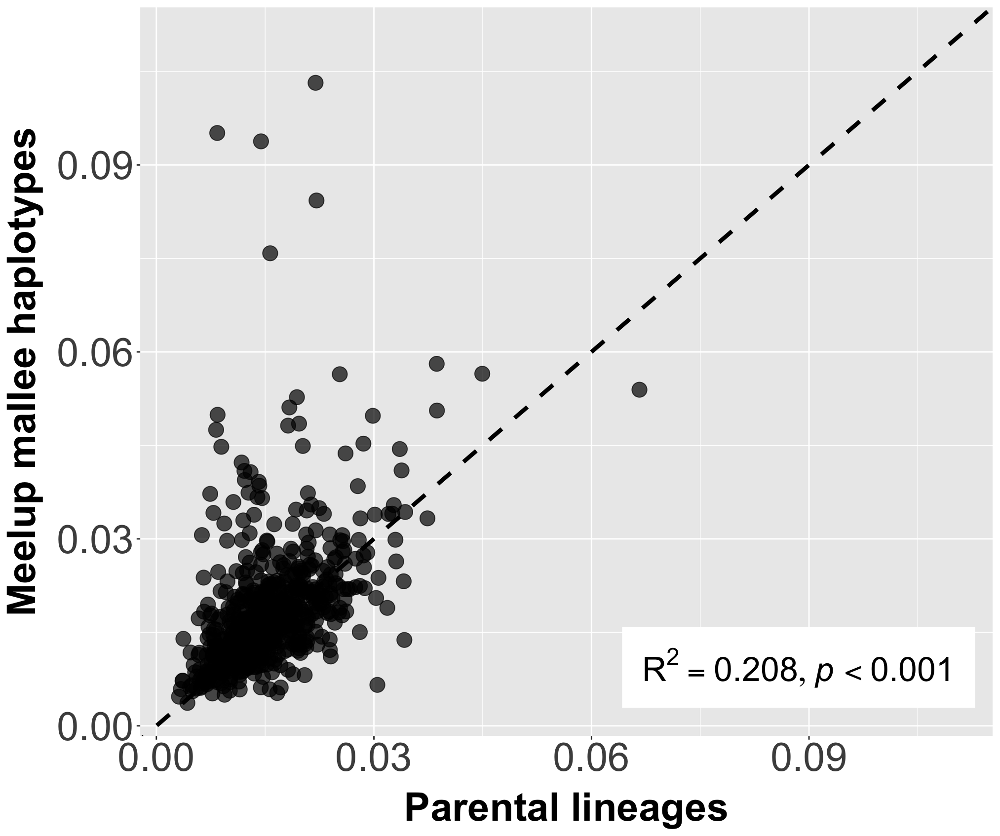
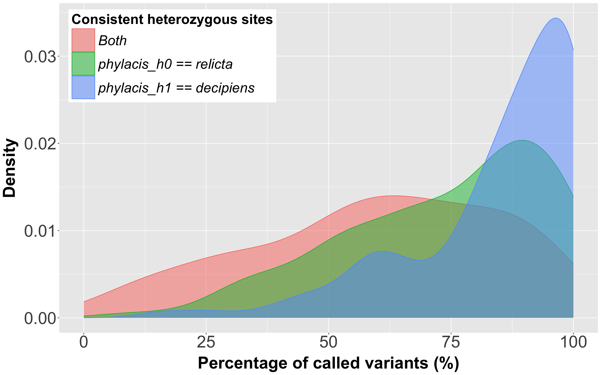
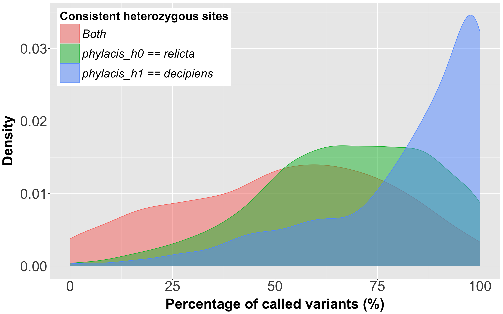
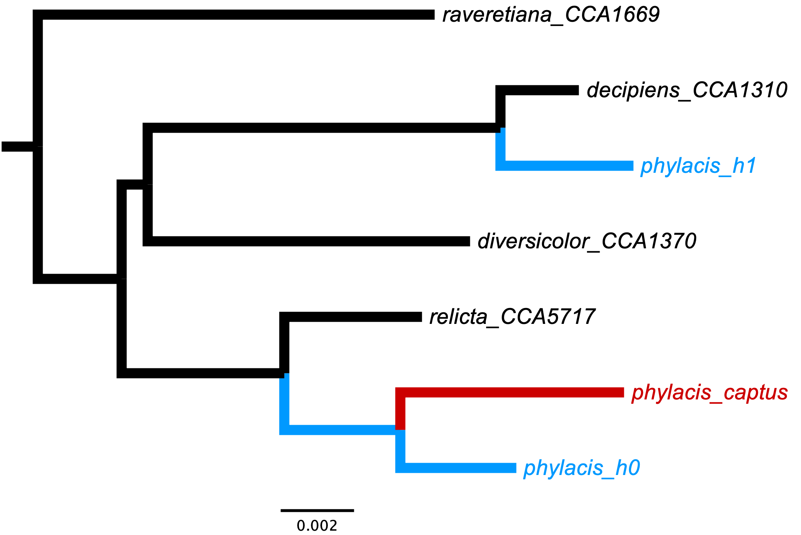

# Example on meelup-mallee short reads
Meelup mallee (*E. x phylacis*) is an F1 hybrid between two eucalypt species, which are hypothesised to be *E. decipiens* and *E. virginea* (<a href="https://doi.org/10.58828/nuy00653">Nicolle & French 2002</a>). Here, we tested different parameters and assessed if we could consistenly recover the two parental lineages across loci. 

## Table of Content
- <a href="#01">Raw Data</a>
- <a href="#02">Running CAPTUS</a>
- <a href="#03">Running ShortReadsPhaser</a>
- <a href="#04">Results: Mapping</a>
- <a href="#05">Results: Phasing</a>
- <a href="#06">Results: Species Tree Inference</a>
- <a href="#07">Using Other Parameters</a>

## <a id="01">Raw Data</a>
The raw short-read data are located at `/home/raw_data/MM/2018_short_reads/`. Each sample is labelled as `MMAA`, `MMAB`, `MMAC`, `MMBA`, etc., where:
- `MM` stands for meelup mallee
- The next letter is the branch ID (A-T)
- The final letter is the leaf ID (A-C)

Each leaf sample has ~6x coverage (based on an average genome size of 500Mb), which means that each branch has roughly 18x coverage across three leaf samples. In addition, each sample was sequenced twice, resulting in ~36x total coverage for individual branches. Among these branches, there are three stems where the sample size is doubled:
- Stem 17: `MMK` and `MMQ`
- Stem 18: `MML` and `MMR`
- Stem 23: `MMS` and `MMT`

Here, we combined the `MML` and `MMR` short reads using `cat` command in Unix, so we have two datasets with ~30x and ~60x coverage. Running `seqkit stats *.fastq.gz` generated the following:
- ~30x coverage: `SN877_0426_MML` + `SN8777_0429_MMR`
    ```
    file                      num_seqs         sum_len  min_len  avg_len  max_len
    phylacis_R1.fastq.gz    55,992,057   8,454,800,607      151      151      151
    phylacis_R2.fastq.gz    55,992,057   8,454,800,607      151      151      151
    ```
- ~60x coverage: `SN877_0426_MML` + `SN877_0427_MML` + `SN8777_0429_MMR` + `SN8777_0430_MMR`
    ```
    file                      num_seqs         sum_len  min_len  avg_len  max_len
    phylacis_R1.fastq.gz   125,404,800  18,936,124,800      151      151      151
    phylacis_R2.fastq.gz   125,404,800  18,936,124,800      151      151      151
    ```

## <a id="02">Running CAPTUS</a>
We ran <a href="https://doi.org/10.1093/sysbio/syag046">CAPTUS</a> on the paired-end reads to extract 1,187 <a href="https://doi.org/10.1093/bioinformatics/btv351">BUSCO</a> loci from <a href="https://doi.org/10.64898/2026.09.25.753384">Ivan et al. (2026)</a> with default parameters. We used the `-d` flag during `captus extract` to set the target loci as miscellaneous DNA markers because the BUSCO sequences are not codons.

> [!NOTE]
> Dataset from Ivan et al. (2026) does not have any *E. virginea* sample. The closest relative to *E. virginea* comes from *E. relicta*.

In brief, CAPTUS starts by trimming the adaptors and cleaning the reads using <a href="https://github.com/bbushnell/BBTools">BBTools</a>. Then, it *de novo* assembles the reads using <a href="https://doi.org/10.1093/bioinformatics/btv033">MEGAHIT</a>, and extracts the target loci from the assembly using <a href="https://doi.org/10.1101/gr.229202">BLAT</a>. This step generates two output files that are relevant to this pipeline:
- `DNA_matches.fna`: individual hits of the target sequences
- `DNA_matches_flanked.fna`: individual hits of the target sequences + additional flanking sequences

## <a id="03">Running ShortReadsPhaser</a>
In `ShortReadsPhaser` pipeline, there are several free parameters to be set by users. Following the specification of our dataset, we used the following values as our `default` parameters (please refer to <a href="../config.yaml">`config.yaml`</a>):
```
# use individual gene trees inferred from Ivan et al. (2026) as backbone trees
dir_backbone_genetrees <- "/home/jeremias/captus/701_sample/tree_treefile/"

# use the CAPTUS output
extraction_tool <- "captus"
phasing_tool    <- "whatshap"

# set the minimum and maximum depths to call a variant
min_depth <- 15     # for 60x-coverage data, and 7.5 for 30x-coverage data
max_depth <- 150    # for 60x-coverage data, and 75 for 30x-coverage data

# in this case, the third rank represents series-level where *E. decipiens* and *E. virginea* differ
taxonomy_rank <- 3

# set the minimum accumulated likelihood weight ratio (alwr) to confidently assign a haplotype placement
min_alwr <- 0.8

# set the minimum fraction of placements that must agree to call a lineage
min_consensus_thresh <- 1.0
```

## <a id="04">Results: Mapping</a>

### Mapping 60x-coverage data to the 1,187 CAPTUS best hits
After running CAPTUS on the 60x-coverage data, we mapped the cleaned short reads to the 1,187 CAPTUS best hits (`DNA_matches_flanked.fna`). We then assessed the mapping statistics as follows:
```
$ samtools idxstats phylacis.dedup.bam | awk '{T+=$2} END {print T}'
  6160664

$ samtools flagstat phylacis.sorted.bam
  249346330 + 0 in total (QC-passed reads + QC-failed reads)
  249094936 + 0 primary
  0 + 0 secondary
  251394 + 0 supplementary
  0 + 0 duplicates
  0 + 0 primary duplicates
  13305405 + 0 mapped (5.34% : N/A)
  13054011 + 0 primary mapped (5.24% : N/A)
  249094936 + 0 paired in sequencing
  124547468 + 0 read1
  124547468 + 0 read2
  8029416 + 0 properly paired (3.22% : N/A)
  8627550 + 0 with itself and mate mapped
  4426461 + 0 singletons (1.78% : N/A)
  571410 + 0 with mate mapped to a different chr
  446208 + 0 with mate mapped to a different chr (mapQ>=5)

$ samtools flagstat phylacis.dedup.bam
  6895181 + 0 in total (QC-passed reads + QC-failed reads)
  6895181 + 0 primary
  0 + 0 secondary
  0 + 0 supplementary
  0 + 0 duplicates
  0 + 0 primary duplicates
  6895181 + 0 mapped (100.00% : N/A)
  6895181 + 0 primary mapped (100.00% : N/A)
  6895181 + 0 paired in sequencing
  3457041 + 0 read1
  3438140 + 0 read2
  6382983 + 0 properly paired (92.57% : N/A)
  6733591 + 0 with itself and mate mapped
  161590 + 0 singletons (2.34% : N/A)
  329849 + 0 with mate mapped to a different chr
  329849 + 0 with mate mapped to a different chr (mapQ>=5)
```

<a href="https://doi.org/10.1038/s41467-020-14998-3">GenomeScope2</a> estimated the genome size of meelup mallee to be roughly <a href="https://github.com/roblanf/MM_genome">530Mb</a> based on long sequencing reads, which means that the total length of the 1,187 BUSCO loci (~6.1Mb, including flanking regions) accounts for **~1.2% of the genome**. If reads were sampled evenly across the genome, there should be ~2.9 million reads that *truly* originate from these loci. However, there are ~6.9 million retained reads after deduplication, which is ~2.4x higher than expectation. In other words, the filtered BAM has over half off‑target reads (i.e., reads that do not come from the BUSCO loci).

We then calculated the per-locus average mapping depth to assess if the extra mapped reads are localised or spread evenly across all loci. To do this, we first calculated the mapping depth of each CDS block using `samtools depth -a phylacis.dedup.bam` (note that a single locus may contain multiple CDS blocks). The median mapping depth across all blocks is 62x, but the average is 105.89x, which reflects that the off-target reads are concentrated in a minority of positions. If we calculated the per-locus average mapping depth across all CDS blocks, there are 133 BUSCO loci with >=150 average depth (Fig. 1).


*<b>Figure 1.</b> Per-locus average mapping depth of the meelup mallee short-read data. Vertical red dashed lines denote the minimum and maximum depths during variant calling. Number of bins = 100.*

## <a id="05">Results: Phasing</a>

### Calculating pairwise genetic distance between *E. decipiens* and *E. relicta*
First, we calculated the pairwise genetic distance between `decipiens_CCA1310` (i.e., a representative sample of *E. decipiens*) and `relicta_CCA5717` (i.e., a closely-related species with *E. virginea*) using the BUSCO alignments from Ivan et al. (2026):
```
library(ape)

files  <- list.files("/home/jeremias/captus/busco_alignments", full.names=TRUE)
ls_ref <- c("decipiens_CCA1310", "relicta_CCA5717")

# iterate over BUSCO loci
out <- do.call(rbind, lapply(files, function(f) {
  # open the BUSCO alignment
  aln <- read.dna(f, format="fasta", as.character=TRUE)
  if (!all(ls_ref %in% rownames(aln))) {
    return(NULL)
  }

  # extract the two reference samples
  m <- aln[ls_ref, , drop=FALSE]
  m <- tolower(m)

  # count the number of sites with no missing data
  ok <- colSums(matrix(m %in% c("a", "c", "g", "t"), nrow=2)) == 2

  # return the number of sites per locus
  data.frame(locus = basename(f),
             diffs = sum(m[1, ok] != m[2, ok]),
             sites = sum(ok))
}))

# calculate the pairwise genetic distance per locus
out$p <- out$diffs / out$sites
```

Across 1,186 BUSCO where *both* were found, the average pairwise genetic distance between the two samples is 1.5% (SD=0.7; Fig.2). This means that there is on average **one heterozygous site every ~70 bp**.


*<b>Figure 2.</b> Distribution of pairwise genetic distance between `decipiens_CCA1310` and `relicta_CCA5717` across 1,186 BUSCO loci. Vertical red line denotes the average across loci. Number of bins = 100.*

### Assessing the performance of <a href="https://doi.org/10.1093/bioinformatics/btv351">WhatsHap</a>
We calculated and compared the number of heterozygous sites per locus called by Bcftools and WhatsHap using:
```
$ bcftools view -H -v snps -i 'GT="het"' phylacis.filtered.vcf.gz | cut -f1 | sort | uniq -c > per_locus_het.tsv
$ whatshap stats --tsv per_locus_whatshap_het.tsv phylacis.phased.vcf.gz
```

The number of heterozygous SNVs called by Bcftools ranges between 1 to 898 (average=126.5) across 1,187 BUSCO loci (Fig. 3). WhatsHap fails to phase 0-15.9% of these SNVs (average=0.3%), which shows that <b>WhatsHap performs well in phasing the variants</b>.


*<b>Figure 3.</b> Distribution of heterozygous SNVs across 1,187 BUSCO called by Bcftools and WhatsHap.*

### Calculating the pairwise genetic distance between the meelup mallee haplotypes
Across 1,187 BUSCO loci (4,713 CDS blocks), we excluded four BUSCO loci (7 CDS blocks) with no recovered haplotypes. We then ran <a href="https://doi.org/10.1093/sysbio/syy054">EPA-NG</a> on individual blocks, and found that the most common parental lineages recovered are `Curviptera` and `Falcatae` (which represent the series of *E. virginea* and *E. decipiens*, respectively).

Across the 4,676 blocks, there were 3,205 blocks unresolved at series-level (`taxonomic_rank==3`), while the rest (1,471 blocks) can be categorised as:

| Criterion                                       | #Blocks |
| ----------------------------------------------- | ------: |
| Either or both haplotypes have alwr >= min_alwr | 721     |
| Both haplotypes have alwr < min_alwr            | 743     | 
| Both haplotypes have the same lineages          | 7       |

Among 721 blocks, 117 blocks (across 114 BUSCO loci) have confident placement for both haplotypes. Following the previous steps, we calculated the pairwise genetic distance between the two haplotypes on each locus, and compared its distribution with the two putative parental lineages across 114 loci (Figs. 3-4). The two distributions are significantly correlated, with R<sup>2</sup> = 0.324 (<i>p</i> < 0.001). The results are also comparable when using the 671 BUSCO loci (Figs. 5-6).


*<b>Figure 4.</b> Distribution of pairwise genetic distances of the two meelup mallee haplotypes and one of the two parental lineages across 114 BUSCO.*


*<b>Figure 5.</b> Correlation between pairwise genetic distances of the two meelup mallee haplotypes and those of the two parental lineages across 114 BUSCO. Dashed line represents x=y line.*


*<b>Figure 6.</b> Distribution of pairwise genetic distances of the two meelup mallee haplotypes and one of the two parental lineages across 671 BUSCO.*


*<b>Figure 7.</b> Correlation between pairwise genetic distances of the two meelup mallee haplotypes and those of the two parental lineages across 671 BUSCO. Dashed line represents x=y line.*

### Calculating the 'true' heterozygous sites called by WhatsHap
We then calculated the 'true' heterozygous sites on the parental lineages that were called by WhatsHap. Here, we compared `phylacis_h0` to `relicta_CCA5717` and `phylacis_h1` to `decipiens_CCA1310` (see <b><a href="#06">Results: Species Tree Inference</a></b>).

```
library(ape)

# extract the list of locus
files  <- list.files("/home/jeremias/captus/busco_alignments", full.names=TRUE)

# set up variables
bases <- c("a", "c", "g", "t")
ids   <- c("phylacis_0", "phylacis_1", "relicta_CCA5717", "decipiens_CCA1310")

# create a function to count the number of heterozygous sites
tally <- function(aln, h0, h1, A, B) {
  # convert all bases to lowercases
  m   <- tolower(aln[c(h0, h1, A, B), , drop=FALSE])

  # extract all sites with valid sites across all four sequences
  m   <- m[, colSums(matrix(m %in% bases, nrow = 4)) == 4, drop=FALSE]

  # extract all heterozygous sites between the parental lineages
  m   <- m[, m[1, ] != m[2, ], drop=FALSE]

  # count the number of consistent (con) and swapped (swp) alleles
  con <- m[1, ] == m[3, ] & m[2, ] == m[4, ]
  swp <- m[1, ] == m[4, ] & m[2, ] == m[3, ]

  # return the count of heterozygous sites
  c(het        = ncol(m),
    h0_rel     = sum(m[1, ] == m[3, ]),
    h1_dec     = sum(m[2, ] == m[4, ]),
    consistent = sum(con),
    swapped    = sum(swp))
}

# count the number of heterozygous sites per locus
out <- do.call(rbind, lapply(files, function(f) {
  # open the BUSCO alignment
  aln <- read.dna(f, format="fasta", as.character=TRUE)
  if (!all(ids %in% rownames(aln))) {
    return(NULL)
  }

  # return the number of heterozygous sites per locus
  data.frame(locus = basename(f), t(tally(aln, ids[1], ids[2], ids[3], ids[4])))
}))
```

Across 114 BUSCO loci, the proportion of correctly-called variants for `phylacis_h0` (in regards to `relicta_CCA5717`) ranges between 9.5% to 100% (average=73.9%; Fig. 7 (green)), while `phylacis_h1` (in regards to `decipiens_CCA1310`) has 16.1-100% correctly-called variants (average=84.8%; Fig. 7 (blue)). Considering both criteria results in a lower average of 59.5% (Fig. 7 (red)), with 0-14.8% (average=0.63%) variants swapped (i.e., `phylacis_h0` follows the `decipiens_CCA1310` alleles, and vice versa) across 114 loci. The results are also comparable when using the 671 BUSCO loci (Fig. 8), showing <b>a higher calling rate for the 'true' *E. decipiens*-specific alleles compared to those from *E. relicta*</b>. However, note that: (i) we use *E. relicta* instead of *E. virginea* as a reference sample, and (ii) the two reference samples are **not** the true parents of the meelup-mallee sample, as the hybrid species is approximately 6,400 years old (<a href="https://doi.org/10.1016/S0006-3207(98)00119-0">Rossetto et al. 1999</a>).


*<b>Figure 8.</b> Proportion of correctly-called variants across 114 BUSCO. Colours denote different criterion used.*


*<b>Figure 9.</b> Proportion of correctly-called variants across 671 BUSCO. Colours denote different criterion used.*

## <a id="06">Results: Species Tree Inference</a>
We inferred concatenated Maximum-Likelihood species trees using two sets of BUSCO loci: 114 BUSCO with confident placement for both haplotypes, and 671 BUSCO loci with confident placement for both *or* either haplotype. Figure 9 shows the placement of each haplotype on the concatenated tree subsetted from the full 704-tip tree (701 samples from Ivan et al. (2026) + 1 unphased meelup mallee haplotype + 2 phased meelup mallee haplotypes). <b>The unphased `phylacis_captus` and the phased `phylacis_h0` are closely-related to `relicta_CCA5717`, while `phylacis_h1` is more closely-related to `decipiens_CCA1310`</b>.


*<b>Figure 10.</b> Subsetted concatenated phylogenetic tree inferred from 114 BUSCO loci. The tree is rooted at `raveretiana_CCA1669` from distantly-related sect.* Domesticae. *Colours denote the two meelup mallee haplotypes (blue) and unphased haplotype (red).*

- Phylogenetic placements on `114-BUSCO` tree (branch lengths):
    - Haplotype one: sister to `decipiens_CCA1310` (0.0036)
    - Haplotype two: sister to `relicta_CCA5717` (0.0064)
    - Unphased (CAPTUS best hits): sister to `relicta_CCA5717` (0.0093)
- Phylogenetic placements on `671-BUSCO` tree (branch lengths):
    - Haplotype one: sister to `decipiens_CCA1310` (0.0044)
    - Haplotype two: sister to `relicta_CCA5717` (0.0084)
    - Unphased (CAPTUS best hits): sister to `relicta_CCA5717` (0.0090)

## <a id="07">Using Other Parameters</a>

> [!NOTE]
> ✅: consistent with output from `default` run<br>
> ❌: inconsistent with output from `default` run

### Using <a href="https://doi.org/10.3732/apps.1600016">HybPiper</a>
Using HybPiper (`extraction_tool = "hybpiper"`) resulted in a smaller number retained BUSCO loci. Using the 101 BUSCO loci with confident placement for both haplotypes (-13 compared to the `default` run) results in an identical species tree topology with the `default` run. However, using the 636 BUSCO loci with confident placement for either haplotype (-35 compared to the `default` run) groups all phased and unphased haplotypes together with `decipiens_CCA1310`.
- Phylogenetic placements on `101-BUSCO` tree (branch lengths):
    - Haplotype one: sister to `decipiens_CCA1310` (0.0054) ✅
    - Haplotype two: sister to `relicta_CCA5717` (0.0077) ✅
    - Unphased (CAPTUS best hits): sister to `relicta_CCA5717` (0.0109) ✅
- Phylogenetic placements on `636-BUSCO` tree (branch lengths):
    - Haplotype one: sister to `decipiens_CCA1310` (0.0073) ✅
    - Haplotype two: sister to `decipiens_CCA1310` (0.0219) ❌
    - Unphased (CAPTUS best hits): sister to `decipiens_CCA1310` (0.0128) ❌

### Using <a href="https://doi.org/10.1101/gr.213462.116">HapCUT2</a>
Using HapCUT2 (`phasing_tool = "hapcut2"`) resulted in a similar number of retained BUSCO loci, with an identical species tree topology and comparable branch lengths.
- Phylogenetic placements on `110-BUSCO` tree (branch lengths):
    - Haplotype one: sister to `decipiens_CCA1310` (0.0037) ✅
    - Haplotype two: sister to `relicta_CCA5717` (0.0059) ✅
    - Unphased (CAPTUS best hits): sister to `relicta_CCA5717` (0.0097) ✅
- Phylogenetic placements on `677-BUSCO` tree (branch lengths):
    - Haplotype one: sister to `decipiens_CCA1310` (0.0045) ✅
    - Haplotype two: sister to `relicta_CCA5717` (0.0085) ✅
    - Unphased (CAPTUS best hits): sister to `relicta_CCA5717` (0.0090) ✅

### <a href="https://github.com/jeremiasivan/ShortReadsPhaser/tree/pairing">Adding a block-pairing test</a>
As we tested the taxonomic placement of each CDS block individually using EPA-NG, informative-but-short blocks might not be confidently placed across gene trees. To address this, we incorporated an additional *pairing* step, where we selected an **anchor** block for each locus (i.e., a block with preferably confident placement for both or either haplotype) and assessed if stitching the anchor block with other blocks would increase the likelihood of the haplotype placements.

We retrieved 127 BUSCO loci with confident placement for both haplotypes (+13 compared to the `default` run), and 700 BUSCO loci with confident placement for either haplotype (+29 compared to the `default` run). The species tree topology is exactly the same with the `default` run.
- Phylogenetic placements on `127-BUSCO` tree (branch lengths):
    - Haplotype one: sister to `decipiens_CCA1310` (0.0042) ✅
    - Haplotype two: sister to `relicta_CCA5717` (0.0067) ✅
    - Unphased (CAPTUS best hits): sister to `relicta_CCA5717` (0.0092) ✅
- Phylogenetic placements on `700-BUSCO` tree (branch lengths):
    - Haplotype one: sister to `decipiens_CCA1310` (0.0047) ✅
    - Haplotype two: sister to `relicta_CCA5717` (0.0085) ✅
    - Unphased (CAPTUS best hits): sister to `relicta_CCA5717` (0.0089) ✅

### Using stricter depth criteria
Following Figure 1, we set a higher `min_depth = 40` and a lower `max_depth = 80` during variant calling. We retained a smaller number of loci compared to the `default` parameters, but the species tree placements of the two haplotypes are consistent with the previous results.
- Phylogenetic placements on `99-BUSCO` tree (branch lengths):
    - Haplotype one: sister to `decipiens_CCA1310` (0.0032) ✅
    - Haplotype two: sister to `relicta_CCA5717` (0.0056) ✅
    - Unphased (CAPTUS best hits): sister to `relicta_CCA5717` (0.0092) ✅
- Phylogenetic placements on `642-BUSCO` tree (branch lengths):
    - Haplotype one: sister to `decipiens_CCA1310` (0.0039) ✅
    - Haplotype two: sister to `relicta_CCA5717` (0.0077) ✅
    - Unphased (CAPTUS best hits): sister to `relicta_CCA5717` (0.0095) ✅

---
*Last update: 28 October 2026 by Jeremias Ivan*